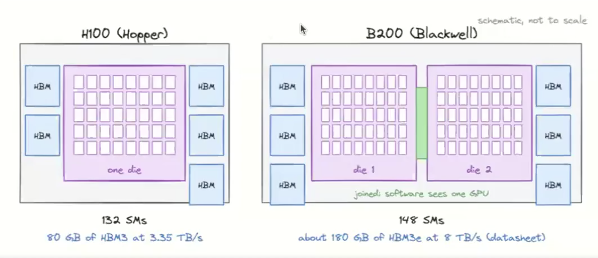
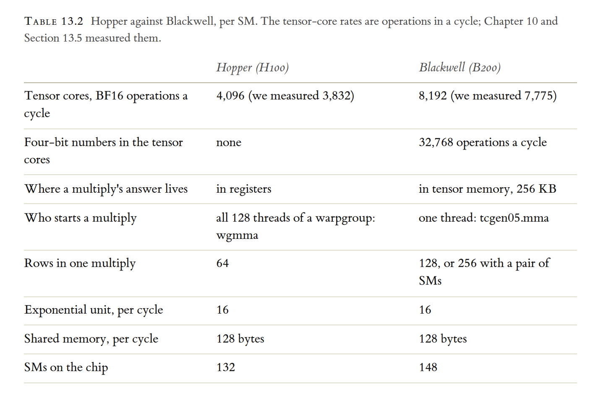

  

***

  

||  Hopper (H100) | Blackwell (B200) ||
|---|---|---|---|
| | FlashAttention2 (FA2) | FlashAttention3 (FA3) ||
|           | One Die    | Two Dies (One GPU) ||
| SMs       | 132        | 148         ||
|---|---|---|---|
| HBM       | 80 GB      | 180 GB      ||
| Bandwidth | 3.35 TB/s  | 8 TB/s      ||
| TMEM      | ---        | 256 KB per SM | New Memory|
|           | - `wgmma`   - wrote results -> Registers | - `tcgen05.mma`    - issued by a single thread -   multiplications -> TMEM ||
|---|---|---|---|
| Tensor Core - BF16 | 4,096 | 8,192  | Twice the Math|
| Tensor Core - NVFP4 | -- | 32,768 | |
|  | No 4-bith Math | 4-bit Math | 4-bit Math |
