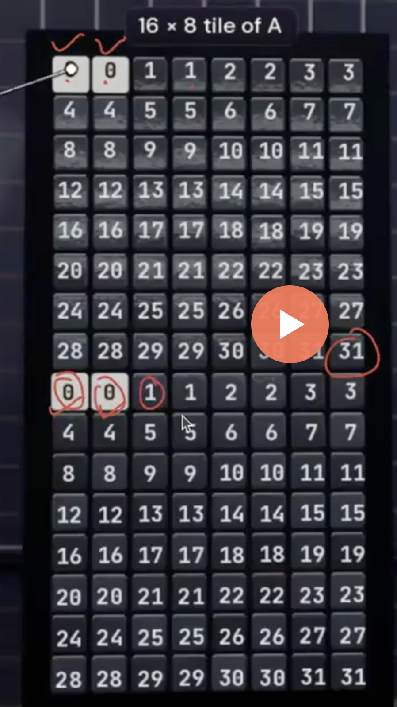
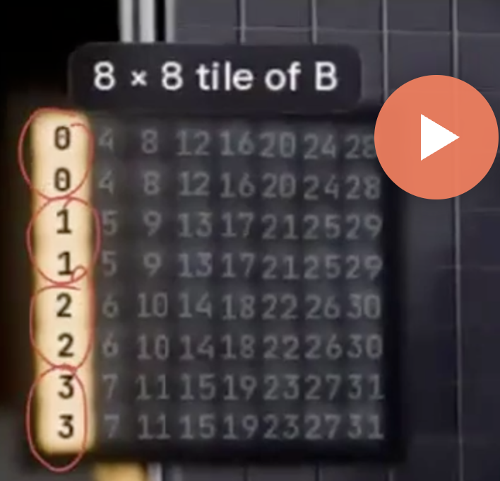
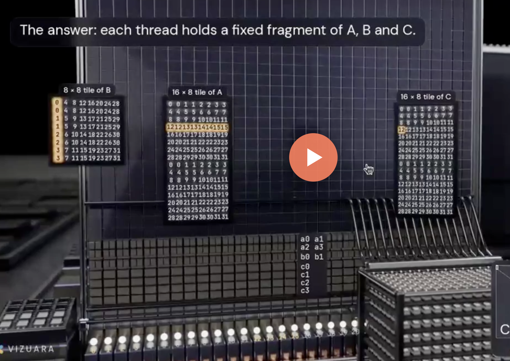
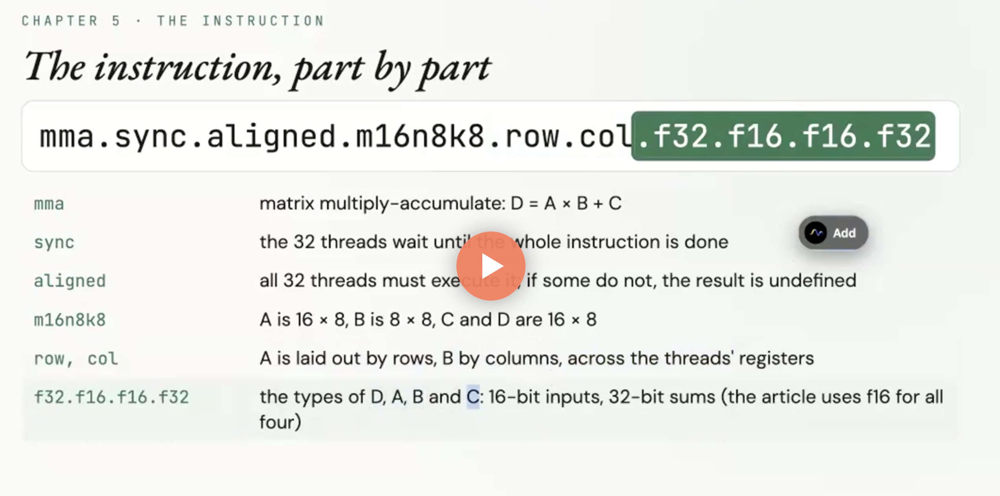

=## Lecture 11
* Tensor cores
* What a tensor core computes in a single instruction, and why it changes the GEMM ladder.
* FP16, BF16 and FP8.
* WMMA and `mma.sync` fragments, `ldmatrix` and shared-memory swizzling.

*** 

* [Muse Spark Open Kernel Challenge](https://openkernelchallenge.dev/)

* 10:00

***

* CUDA cores
* Tensor cores - tiling

#### Example
* A[4096,4096] * B[4096,4096] = C[4096,4096]
* Multiply and Add Operations = $2n-1 \times n^3 = 2 \times n^3$ = 137.4 Billion
* [H100](https://github.com/muarshad01/Kernel-Engg/blob/main/H100.md)

|||
|---|---|
| Operations   |  137.4 billion |
| Time         | $\frac{137.4 ~\text{billion ops}}{67 ~\text{trillion ops/s}}=2,052 ~\mu ~sec$ |
| Time cuBLAS  | $2,658 ~\mu ~sec$ |
| Time best kernel 10  | $3,523 ~\mu ~sec$ |

***

#### What exactly is TC?
* 30:00

* Matrix Multiply Accumulate
```cuda
mma.sync
```

* One FFMA (Fused Floating-point Multiply-Add) did 32 multiply-adds. This one instruction does 1,024
* One instruction 1,024
* CUDA core: One Instructio or 32 threads.

***

* 2,048 multiply-add in one tick
*   512 multiply-add in one tick (each quadrant)
* CUDA core: 32 multiply-add in one tick (32 lanes)

***

* 1:00:00

* A[4096,4096] * B[4096,4096] = C[4096,4096]

* __Step 1__: Block Size tile: C[256,128] = A[256,4096]  * B[4096,128] 
* __Step 2__: Load chunk of A and Chunk of B into shared mem
* __Step 3__: Warp Tile: - each warp gets its 64x64 tile
* __Srep 4__: Tensor Core tile: 16x8

*** 

* 2:00:00

#### Mapping to Threads
Therads = $\\{T_1, T_2, \ldots, T_{32}\\}$
* 16x8 tile of A and C matrix = 128 elements
* every thread actually gets 4 numbers

<p aling="center">

</p>

* 8x8 tile of B matrix = 64 elements
* every thread actually gets 2 numbers

<p aling="center">

</p>

***

#### Fragments of Thread

* C[3,0]
* A Tensor core reaches ALL 32 threads' registers at once.
* That is why the whole warp must issue the instruction, together.
* ALL 32 threads `mma.sync` instruciton.
* Each threads share of tile is called a fragment.

<p aling="center">
  
</p>

***

* 2:15:00

```cude
2 x ldmatrix.x4              A's slice
2 x ldmatrix.x2.trans        B's slice

mma.sync x 32
```

<p aling="center">
  
</p>

* 2:25:00

* 

#### Swizzling

***


