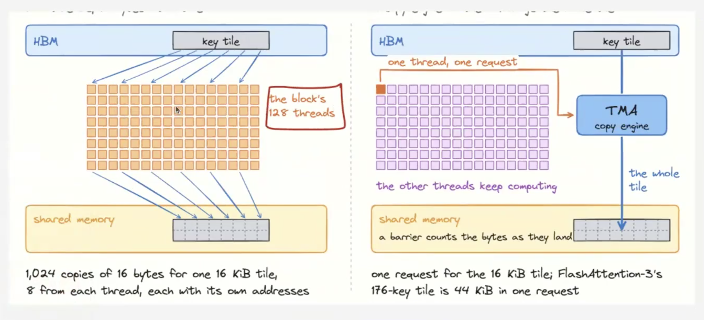

## FlashAttention 2 & 3

#### FA1
|||
|---|---|
| - $N_{tokens}$ <br> - Seq length during pretraining | 4,096|
| dim | 128 |
| $n_{heads}$ | 32 | 
| Query Matrix ($Q_{N\times d}$) | $4,096 \times 128$ |
| Key Matrix ($K_{N\times d}$)   | $4,096 \times 128$ |
| Query Value ($V_{N\times d}$)  | $4,096 \times 128$ |

***

#### FA-2: Tiling - Online softmax
* **Shared Memory** will initially have: $Q_1 (128,128)$, $K_1 (64,128)$, and $V_1 (64,128)$
* Then discard $K_1$, and $V_1$ and bring $K_2$, and $V_2$,..., and so on.
* ...
* Then bring $Q_2 (128,128)$...

|||
|---|---|
| $Q_1$  | - $\\{K_1, K_2, ..., K_{64}\\}$ <br> - $\\{V_1, V_2, ..., V_{64}\\}$|
| $Q_2$  | - $\\{K_1, K_2, ..., K_{64}\\}$ <br> - $\\{V_1, V_2, ..., V_{64}\\}$|
| ...    | ...|
| $Q_{32}$ | - $\\{K_1, K_2, ..., K_{64}\\}$ <br> - $\\{V_1, V_2, ..., V_{64}\\}$|

* 10:00

***

#### FA-2: Blocks launched by FlashAttention
* Query Matrix ($Q_{N\times d}$) = $4,096 \times 128$
* $Query_{tile} = 128 \times 128$
* $Key_{tile} = 64 \times 128$
* $Value_{tile} = 64 \times 128$
* Number of $Q_{tiles}$ in 1 head = $\frac{4096}{128} = 32$
* Number of $Q_{tiles}$ in 32 head  = $32 \times 32 = 1,024$

***
| FlashAttention | Number of blocks | Number of heads | Number of query tiles | Active SMs |
|---|---|---|---|---|
| FA-1 | 32 | 32 | | $\frac{32}{132}$ filled only <br> - Inside block: One query tile after other - $\\{Q_1, Q_2, ..., Q_{128}\\}$ (sequential) not exploiting inherent parallelism | 
| FA-2 | 1,024 | 32 | 1,024 |     |
* First Optimization of FA-2: Query tiles are independent of each other and they can be divided across SMs.

***

* 35:00

#### FA-2: Inside Blocks

#### Two types of parallelism across warps
* $Q_{tile}= 128 \times 128$
* $K_{tile} = 64 \times 128$
* $V_{tile} = 64 \times 128$
* We have 4 Warps ($\\{w_1,w_2,w_3,w_4\\}$) - 128 threads


| Type | Query | Keys|
|---|---|---|
| FA-1 | $Q_{tile}= 128 \times 128$ | - Partition $K_{tile}$ into 4 Warps <br> - $\\{k_1=16,k_2=16,k_3=16,k_4=16\\}$  |
| FA-2 | - Partition $Q_{tile}$ into 4 Warps <br> - $\\{q_1=32,q_2=32,q_3=32,q_4=32\\}$ | $K_{tile} = 64 \times 128$ |

* NOTE: Since a Q needs all Keys, approach-2 is better

***

* Online softmax is slightly different b/w FA-1 and FA-2

*** 

* 40:00

| Core | Operations/tick |
|---|---|
| Tensor Core | 4096 |
| SFU | 16 |

***

* 45:00

## FA-3 - [H-100]
* [Modal GPU Glossary](https://modal.com/gpu-glossary/device-hardware/streaming-multiprocessor)
* **Too1-1**: Tensor Memory Accelerator (TMA)
* **Tool-2**: WarpGroup Matrix Multiply-Accumulate (WGMMA)
  * `wgmma.mma_async` versus `mma sync`
* Producer Consumer

#### Example: Data Copy
* Consider $Key_{tile} = 64 \times 128$.

$$
\begin{align}
\text{How ~many ~number ~are ~there} &= 64 \times 128 ~(BF16) \\
                                     &= 16,384 ~bytes ~need ~to ~be ~copied ~from ~HBM ~and ~brought ~to ~shared ~memory \\
                                     &= 1,024 ~copies ~of ~16 ~bytes \\
\end{align}
$$

* 1 block = 4 warps = 128 threads
* 1,024 copies of 16 bytes = 128 threads
* This means, each thread has to do 8 copies
* **Drawback**: ALL 128 threads are busy copying
* **[H100]** -> only 1-thread does the copy and remaning 127 are available for computation!!!

<p align="center">
  
</p>

***

* 1:15:00

* Consider block = 384 threads = 3 warp group of 128 threads each
* 1-wg: Producer (only copies)
* 2-wg: Consumer-1
* 3-wg: Consumer-3

***

* 1:25:00

* Wgmma
* consumer-1 Tensor Core
* consumre-2 SFU

***

* 1:50:00

```
tma <td> gptr sptr
async
```


