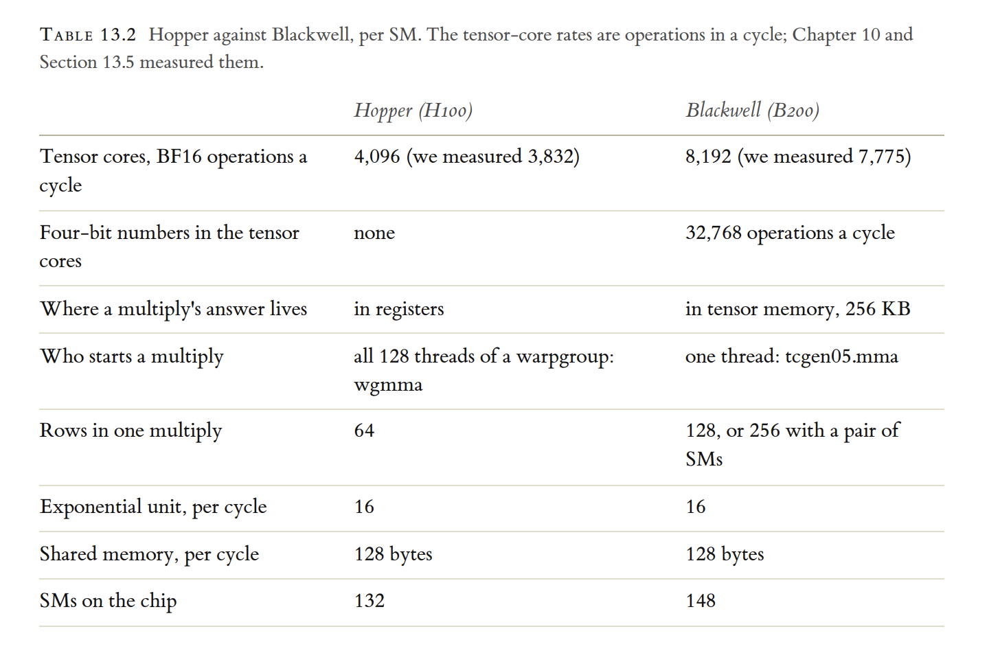

## Blackwell and NVFP4: training a language model in 4 bits
* In this class, we train a language model end to end on a B200 in NVFP4 (NVIDIA FP4).
* What changed from Hopper to Blackwell: tensor memory beside the tensor cores, one thread that starts a multiply, and two SMs that share one.
* Why 4-bit math is a big deal, how a floating-point number works, the E2M1 ladder and NVFP4's two levels of block scaling, and the two Blackwell instructions that quantize and multiply.

***

  

|| H100 (Hopper) | B200 (Blackwell)|
|---|---|---|
|     | Single Die | Double Die |
| SMs | 132 | 148 |
| HBM | 80 GB | 180 GB|
| Bandwidth | 3.35 TB/s | 8 TB/s |

***

  

***

#### Thinking Machines Lab
* [The Inkling family](https://thinkingmachines.ai/inkling/)
* Inkling 2 Small is the largest model we are aware of that was trained end-to-end with a native 4-bit forward pass.
* [End‑to‑End 4‑Bit Training](https://thinkingmachines.ai/blog/end-to-end-4-bit-training/)
* [4-Bit Training, Tested on a Real B200 - VIZUARA](https://4bit.vizuara.ai/)
 
***

* 10:00

#### Blackwell - What is different?
* 1 - TMEM
* 2 - Who issues an instruction
* 3 - CTA Pairs (Co-operative Thread Array)

***

* 1:10:00

#### Quantization 4-bit (Blackwell)

***

* 1:50:00

#### NVFP4 
1. E2M1
2. Block of size 16
3. Each block has own scaling factor stored as block of 8-bit

***

* 2:25:00

* Project (e2e 4-bit pretraining)

***

