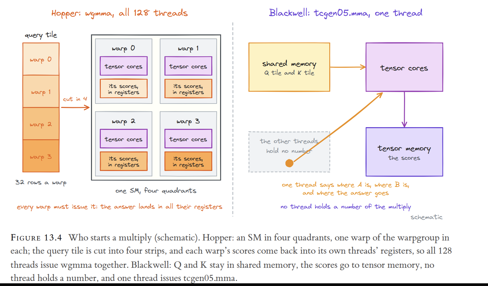

## Blackwell and NVFP4: training a language model in 4 bits
* In this class, we train a language model end to end on a B200 in NVFP4 (NVIDIA FP4).
* What changed from Hopper to Blackwell:
1. `Tensor memory (TMEM - 256KB)` beside the tensor cores,
2. ONE thread (`tcgen05.mma.cta_group::2`) that starts a multiply, and
3. TWO SMs that share one (`Co-operative Thread Array (CTA)` pairs).
* Why 4-bit math is a big deal, how a floating-point number works, the **E2M1** ladder and NVFP4's two levels of block scaling, and the two Blackwell instructions that quantize and multiply.

***

#### Thinking Machines Lab
* [The Inkling family](https://thinkingmachines.ai/inkling/)
* Inkling 2 Small is the largest model we are aware of that was trained end-to-end with a native 4-bit forward pass.
* [End‑to‑End 4‑Bit Training](https://thinkingmachines.ai/blog/end-to-end-4-bit-training/)
* [4-Bit Training, Tested on a Real B200 - VIZUARA](https://4bit.vizuara.ai/)
  * Faster
  * Preserves Inference Quality

***

* [H100 versusw B200](https://github.com/muarshad01/Kernel-Engg/blob/main/H100-versus-B200.md)

***

* 20:00

#### FlashAttention
* $Q_{tile} = 128 \times 256 = 32,768$ (Stored in Shared memory - Registers)
* Registers per threads = 32,768/128 = 32k / 128 = 256 (limit!!!)
* [SM Limits](https://github.com/muarshad01/Kernel-Engg/blob/main/H100.md)
1. Threads
2. Shared Mem
3. Registers

* **Remember**:
  * Consumer WG1 (64 x 128 = 16k/128)
  * Consumer WG2 (64 x 128 = 16k/128)

#### Register Bottleneck
| Case-1 | Case-2 |
|---|---|
| wg:128    | wg: 64   |
| Register limit | ---      |
| 2x speed  | 1x speed |
* Don't keep these number in Registers
* Use a new memory: Tensor Memory (TMEM)

#### [TMEM GPU Gloassary - Modal](https://modal.com/gpu-glossary/device-hardware/tensor-memory)
* 128 lanes
* 512 columns
* TMEM: $128 \times 512 \times  4 bytes = 256$ KB per SM  

***

* 40:00

#### Blackwell - What is different?
1. Tensor mem (TMEM) - 256 KB
2. Who issues an instruction, starts the multiplier?
* (Hopper - `wgmma`
* Blackwell - TMEM: No threads holds any number of multiplication operand. Registers are empty. One thread (`tcgen05.mma.cta_group::2`) out of 128 is nominated.
3. Co-operative Thread Array (CTA) pairs -
* NVIDIA terminology for block

  

***

* 1:10:00

#### QUANTIZATION
* [Quantization - Inference Course](https://github.com/muarshad01/Inference-Engg/blob/main/Lectures/Lecture-7.md)
* (NVFP4/MXFP4 - E2M1) ~ 3.64 x BF16
* 4x math rate
* 3.5x fewer bytes transferred from HBM (Arithmetic Intensity (AI) increases)
* Model is 3.5x smaller

* 1:40:00

#### FP4: 4-bit 
* S-M-E: $(-1)^s \times 1M \times 2^{(E-1)}$
* 1 sign bit

||||
|---|---|---|
| --M3 | $\\{0, 0.5, 1, 1.5, 2, 2.5, 3, 3.5\\}$ | Highest precision; lowest range. |
| E2M1 | - $\\{0, 0.5, 1, 1.5, 2, 3, 4, 6\\}$   - 16 possible values   | Good precision at lower numbers. Convenient tradeoff. |
| E3-- | $\\{0, 0.5, 1, 2, 4, 8, 16, 32\\}$     | Lowest precision; highest range. |

***

* 2:00:00

#### Scaling and How to Scale (Block Scaling)
||||
|---|---|---|
| Scale           | $\frac{max(\lvert x \rvert)}{6}$ | Scaling is important   otherwise, most numbers map to zero. |
| q = Quantization| $\lceil\frac{x}{scale}\rceil$ ||
| De-quantization | q x scale ||

1. E2M1
2. **Block Scaling**: Block of size 16 (16 consective values); 
3. Each block has own scaling factor stored as block of 8-bit [E4M3].

***

* 2:20:00

* Project (e2e 4-bit pretraining)

***

