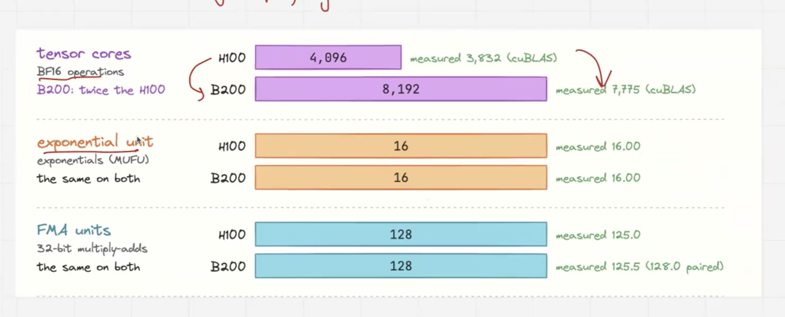
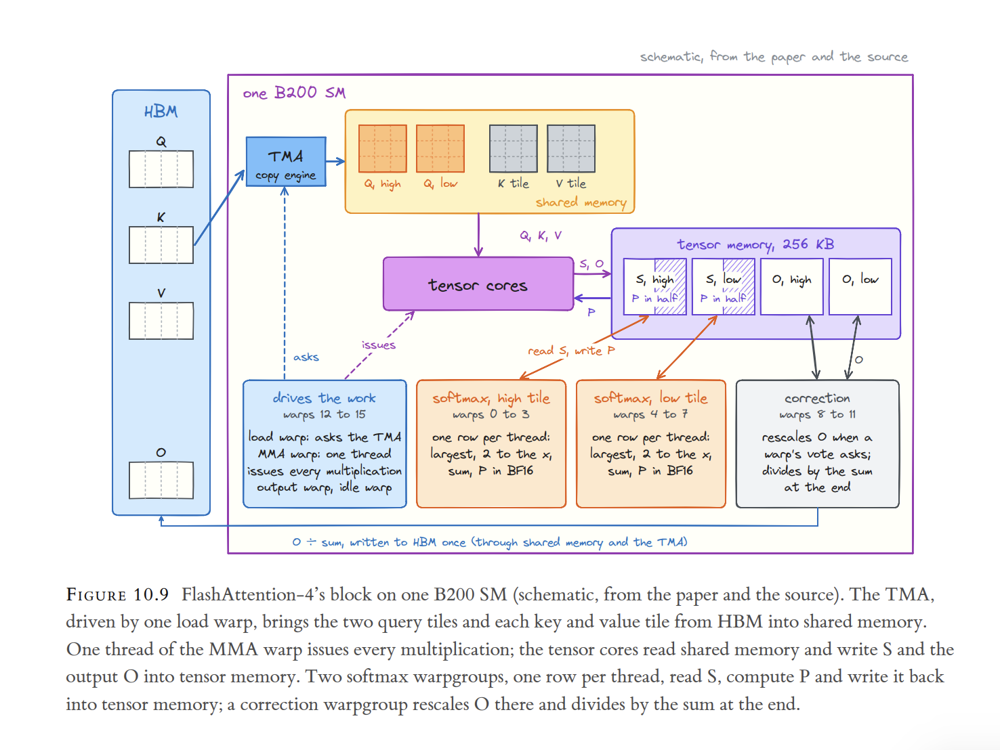

## Flash Attention 4 (FA4)
* From FlashAttention 3 on Hopper to FlashAttention 4 on Blackwell.
* Why, on the newest chips, the exponentials in softmax rather than the matrix multiplications become the limit, and the tricks FA4 uses to work around it.

*** 

* [Hopper versus Blackwell](https://github.com/muarshad01/Kernel-Engg/blob/main/H100-versus-B200.md)

***

* 15:00

#### FA4
* Bigger query tiles
  * $Q_1(128, 128), Q_2(128, 128)$
* Asymmetric hardware scaling

  

***

* 30:00

  

### FA4: 4 Warp Groups = 16 Warps = 512 threads
* wg1 (`tcgen05.mma`) - drives work on TCs
* wg2, wg3 - Softmax 
* wg4 - corrections

*** 

* 50:00

#### Fused Multiply Add (FMA)
* What is we smartly convert and exponential operation in a multiplication operation
* $2^{\log_2 (e^x)}=e^x$ very close to $2^x$
* $2^{-3.37} = \underbrace{2^{.63}}_{FMA} \times \underbrace{2^{-4}}_{move ~around ~expo ~bits}$
* Polynomial approximation
* $2^{f} = 1+.69152f + .227f^2+0.077f^3$ (RHS is three Fused multipliers)
* $(-1)^s\times 2^{(E-127)}\times 1M$

***

